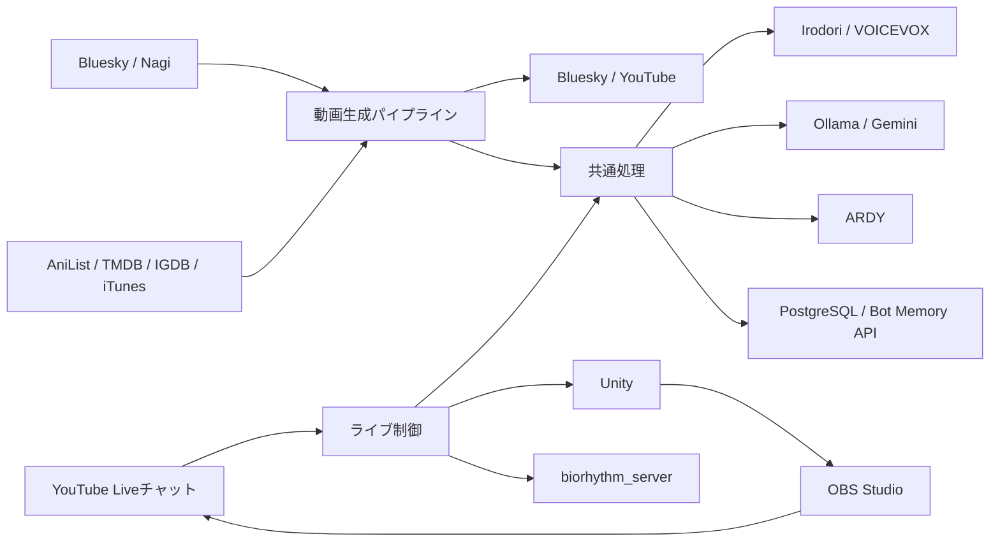

# bot-tan-youtuber

全肯定botたんの動画生成・投稿と、YouTube LiveでのAITuber配信を運用するシステムです。SNSの投稿を紹介する夜の縦動画、朝の作品紹介Shorts、視聴者と会話するライブ配信を、共通の音声合成・モーション生成・記憶基盤で実行します。

本書は、本リポジトリの現行実装に基づく機能仕様と導入・運用手順を定義します。Unityプロジェクト、音声合成サーバー、記憶基盤は別リポジトリで管理します。

## 目次

- [1. システムの範囲](#1-システムの範囲)
- [2. システム構成](#2-システム構成)
- [3. 機能仕様](#3-機能仕様)
- [4. データと設定](#4-データと設定)
- [5. 導入手順](#5-導入手順)
- [6. 実行と動作確認](#6-実行と動作確認)
- [7. 障害時の動作と運用](#7-障害時の動作と運用)
- [8. 関連資料とライセンス](#8-関連資料とライセンス)

## 1. システムの範囲

| 機能 | 入力・処理 | 出力先 | 標準スケジュール（JST） |
|---|---|---|---|
| 夜の縦動画 | Bluesky / Nagiの投稿を選び、紹介台本・音声・映像を生成 | Bluesky | 毎日18:00 |
| 朝の作品紹介Shorts | 曜日ごとのテーマで作品を選び、検索で調べた事実から紹介動画を生成 | YouTube | 毎日06:00 |
| 配信枠の事前準備 | 次の2回の配信枠を作成・再利用し、視聴URLを保存 | YouTube / 共有DB | 毎日04:00 |
| ライブ配信 | コメントへの返答、フリートーク、字幕・モーションの制御 | YouTube Live | 土曜20:40起動、21:00–22:00配信 |
| Unityライセンス確認 | 有効期限の確認と保存済み認証による更新 | ログ / Discord通知 | 毎日12:00、および各ジョブ開始前 |

夜の縦動画はYouTubeへ投稿しません。朝版は2026-10-17にクイズから作品紹介へ切り替え、毎日投稿します。`MORNING_FORMAT=quiz`でクイズに戻せます。クイズは`shorts/turn.py`がJSTの日付の通し番号が偶数の日だけ実行を許可し、`SHORTS_ALTERNATE_DAYS=false`で毎日実行になります。

スケジュールの定義は[setupのtimer](./setup/)と[live/schedule.py](./live/schedule.py)です。配信枠の事前準備は、インストール済みの配信timerの曜日を参照します。未インストール時はリポジトリ内のtimerを参照します。

## 2. システム構成

### 2.1 処理と外部サービス



| 依存先 | 用途 | 標準接続先・管理元 |
|---|---|---|
| Unity | VRMの収録・ライブ描画、音声再生 | ライブHTTP API: `localhost:2338` |
| OBS Studio | 映像・字幕・音声の合成とRTMP送出 | obs-websocket。接続情報は`.env` |
| Irodori-TTS | 標準の音声合成 | `localhost:10110`、`bot-tan-tts` |
| VOICEVOX | 音声合成の代替、字幕用モーラ時刻の取得 | `localhost:10101` |
| Ollama | ローカルLLMによる台本・返答・分類 | `localhost:11434` |
| Gemini | LLM切り替え先、Google検索を伴う調査 | APIキーを設定 |
| ARDY | テキストからVRMAモーションを生成 | `127.0.0.1:2337`、`text-to-vrma` |
| PostgreSQL / Bot Memory API | 投稿、会話、配信枠、記憶・読み辞書の参照と保存 | `.env`で接続先を設定 |
| biorhythm_server | 気分・活動・energyの取得 | `localhost:3002`、`bsky-affirmative-bot` |
| Discord | ジョブ失敗・復旧・配信品質の通知 | Webhookを設定 |

### 2.2 リポジトリ構成

```text
common/           設定、LLM、音声、ARDY、DB、OAuth、ライセンス確認の共通処理
shorts/           夜の縦動画・朝の作品紹介（旧: クイズ）の生成と投稿
live/             配信枠、チャット、会話、記憶、Unity・OBSの制御
setup/            systemd、Xorg、openboxの設定とインストーラ
  patches/        外部サーバーに必要な互換性修正
tools/           OBSシーン構築、背景導入、モーションプール構築など
data/            クイズ、BGM、演出素材、モーションなど
docs/            調査記録と参照資料
tests/           自動テスト
run.sh           夜の縦動画の起動
run_quiz.sh      朝のShorts（作品紹介 / クイズ）の起動
run_live.sh      ライブ配信の起動
.env.example     環境設定のテンプレート
```

### 2.3 関連リポジトリ

| リポジトリ | 管理する内容 |
|---|---|
| `bsky-affirmative-bot` | ペルソナの原典、記憶DB、Bot Memory API、biorhythm、SNS運用 |
| `bottan-video` | Shorts収録用Unityプロジェクト |
| `bottan-video-dev` | `-liveMode`で常駐する配信用Unityプロジェクト |
| `text-to-vrma` | ARDYエンジン |
| `bot-tan-tts` | Irodori-TTSサーバー、参照音声、音声利用条件 |

## 3. 機能仕様

### 3.1 夜の縦動画

1. Bluesky / Nagiの投稿と関連情報を取得し、紹介対象を選択します。
2. 掴み・紹介・決め台詞がループにつながる台本を生成します。他人の投稿は他人の話として扱い、botたん自身の体験に置き換えません。
3. 音声と字幕時刻を生成し、IrodoriのGPU解放を確認してからARDYでモーションを生成します。
4. ARDYを停止してUnityで収録し、ffmpegで字幕、BGM、カット、山場の演出を合成します。
5. MP4と投稿用JSONを作成し、Blueskyへ投稿します。投稿記録は別システムのおやすみポストでも利用します。

`data/chibi/`のPNGと`data/se/`の効果音を使って山場を演出します。素材がない演出は省略します。`SKIP_BLUESKY=true`では投稿を省略し、MP4と投稿用JSONを残します。夜版では`SKIP_YOUTUBE=true`も同じ意味です。

### 3.2 朝の作品紹介Shorts

曜日ごとのテーマ（月: 新作アニメ、火: 名作アニメ、水: 新曲、木: 新作ゲーム、金: 新作映画、土: 名作映画、日: 新作ドラマ）で作品を1本選び、約30秒の紹介動画を生成してYouTubeへ投稿します。対応は`shorts/pickup_sources.py`の`WEEKDAY_THEMES`です。

1. AniList・iTunes・TMDB・IGDBから候補を取得し、紹介済み（`data/pickup_used.csv`）を除いて選びます。ドラマはテレビ放送の作品に限り、成人向けの作品は除きます。
2. Geminiの検索グラウンディングで作品の事実を調べます。検索が走らなかった作品は使わず、次の候補へ進みます。
3. ローカルLLMが調査メモの範囲で台本を書きます。名作の「〇年前の今週」、字数、賞の名前、機種・配信サービス名はコードで検証・修正します。
4. 画面上部のパネルにアートワーク・作品名・日付・画像の出典を表示します。タイトルは作品名から始めます。

テーマは`PICKUP_THEME`または`--theme`で固定でき、`--stage script`で台本まで確認できます。台帳への記録は`PICKUP_NO_CONSUME=true`で抑止します。映画・ドラマには`TMDB_API_KEY`、ゲームには`IGDB_CLIENT_ID`と`IGDB_CLIENT_SECRET`が必要です。

#### 朝のクイズ（`MORNING_FORMAT=quiz`）

クイズCSVから問題を選択し、出題・思考時間・解答を含む台本、音声、モーション、縦動画を生成してYouTubeへ投稿します。使用済み問題は`data/quiz_used.csv`で管理します。

`--quiz-id`で問題を指定でき、`--stage`で台本・音声・動画再合成の段階を選べます。`--preview`はUnity収録を単色背景に置き換えます。投稿抑止と問題の消費抑止は、それぞれ`SKIP_YOUTUBE=true`と`QUIZ_NO_CONSUME=true`で指定します。

### 3.3 配信枠とライブのライフサイクル

事前準備ジョブは次の2回の枠を用意します。DBに保存した枠、またはYouTube上の再利用可能な枠を確認し、重複作成を避けます。この段階ではUnity・OBS・RTMP送出を起動しません。

| 時刻（JST） | ライブの動作 |
|---|---|
| 20:40 | ディスプレイの再初期化・描画確認、ライセンス確認、モデル読み込み、Unity・OBS起動、当日枠への送出準備 |
| 開始前 | YouTubeの`testing`遷移とUnityの実測fpsを確認 |
| 21:00 | `live`へ遷移し、挨拶とコメント対応を開始 |
| 21:55 | 通常の会話ループを終了し、クロージングを開始 |
| 22:00 | 配信を終了し、送出停止・終了処理を実行 |

時刻は`LIVE_START_HHMM`、`LIVE_CLOSING_HHMM`、`LIVE_END_HHMM`で設定します。起動時刻はtimer側で変更します。クロージング開始後に届くコメントは通常の返答処理の対象外です。

### 3.4 会話と記憶

- YouTubeチャットを取得し、優先度と受信時刻に従って返答します。キューの上限は200件です。
- 一般コメントは既定180秒を超えて滞留すると破棄します。スパチャ・メンバー・オーナーのコメントは古さだけでは破棄しません。
- コメントがない場合は、記憶・SNS投稿・近況などからフリートークを生成します。既定の待機時間は25秒です。
- 話題の続きは既定8秒の間隔で、最大2段階まで掘り下げます。コメントが来た場合は、割り込み可能な発話を文の切れ目で切り上げます。
- 話題の重複と同じ近況への偏りを抑制します。在庫を使い切った場合は再利用します。
- 自分の出来事と他人の投稿をプロンプト内で分け、会話履歴にも出どころを保持します。
- 調査が必要な語は分類・記録し、後続の記憶検索に利用します。返答のたびに外部検索の完了を待つ運用にはしません。

記憶はSQLとBot Memory APIを併用します。energyのコメント加算は`bsky-affirmative-bot`側が保存済みコメントを取り込んで行い、配信側では二重加算しません。

### 3.5 音声・字幕・モーション

標準音声はIrodori-TTSです。読み辞書を適用し、300字以内に分割して合成します。復旧できない合成エラーは文全体をVOICEVOXで再合成します。`TTS_ENGINE=voicevox`でVOICEVOXを主エンジンにできます。

字幕・モーションの尺はWAVの実測時間に合わせます。モーラ時刻はVOICEVOXから取得し、Irodoriの実測尺へ伸縮するため、Irodori使用時もVOICEVOXが必要です。読み辞書は共有DBで管理し、字幕の日本語表記は置換しません。

ライブはOllama・Irodori・ARDYを同時稼働させます。GPU OOMやIrodoriの読み込み容量不足が発生した場合、その配信中のARDYを停止し、保存済みモーションで継続します。モーション指示の安全化と見た目の調整は共通処理で管理します。

## 4. データと設定

### 4.1 設定の管理

リポジトリルートの`.env`を動画とライブで共有します。設定項目の説明は[.env.example](./.env.example)、共通パスは[common/env.py](./common/env.py)、ライブ固有の既定値は[live/config.py](./live/config.py)を参照してください。起動スクリプトへ渡した`KEY=VALUE`は環境変数として適用されます。

| 分類 | 主な設定 |
|---|---|
| Unity | `UNITY_EXE`、`UNITY_PROJECT`、`UNITY_LIVE_PROJECT`、`LIVE_DISPLAY` |
| LLM | `USE_LOCAL_LLM`、`LOCAL_LLM_MODEL`、`GEMINI_API_KEY` |
| 音声 | `TTS_ENGINE`、`IRODORI_URL`、`IRODORI_VOICE`、`VOICEVOX_URL` |
| 投稿・配信 | YouTube OAuth、Bluesky資格情報、`LIVE_YOUTUBE_PRIVACY` |
| OBS | `OBS_HOST`、`OBS_PORT`、`OBS_PASSWORD`、`OBS_COLLECTION`、`OBS_PROFILE` |
| 表示・音声経路 | `SUBTITLE_DIR`、`LIVE_AUDIO_SINK` |
| 検証 | `SKIP_BLUESKY`、`SKIP_YOUTUBE`、`QUIZ_NO_CONSUME`、`DRY_RUN`、`FAKE_COMMENTS` |

資格情報は`.env`やOAuthトークンで管理し、リポジトリへ追加しません。YouTube OAuthトークンは動画とライブで共有します。

### 4.2 OBSの参照先

本番と開発環境で字幕の参照先がずれないよう、`SUBTITLE_DIR`にはリポジトリ外の共通の絶対パスを設定します。`.env.example`は`~/.local/share/bottan-live/obs`に相当するパスを指定しています。未設定時のコードの既定値は`data/obs`です。

| 表示・音声 | 現行のシーン構築ツールが設定する参照先 |
|---|---|
| 日本語・英語字幕 | `SUBTITLE_DIR/subtitle_ja.txt`、`subtitle_en.txt` |
| コメント・時計 | `SUBTITLE_DIR/comments.txt`、`clock.txt` |
| energy | `http://localhost:3002/image.png` |
| botたんの声 | `LIVE_AUDIO_SINK`のmonitor（既定`bottan_live.monitor`） |
| BGM | リポジトリ内の`data/bgm/ohirusugi.mp3` |

`live/gauge.py`は`SUBTITLE_DIR/energy.html`も生成しますが、`tools/build_scene.py`のブラウザソースは上記のURLを使用します。字幕ファイルに加え、発話中はobs-websocket経由の表示更新も行います。

### 4.3 成果物と記録

動画パイプラインはMP4、音声、タイムライン、投稿用データなどを生成します。夜版の投稿抑止時はログに表示されるMP4と`*_bluesky.json`を確認してください。一時ファイルの保持は`KEEP_TEMP`、クイズでは`--keep-temp`でも指定できます。

作品紹介の候補API（AniList・Apple Music・TMDB・IGDB）、認証トークン取得、画像取得、Gemini検索は、タイムアウト・接続切断・HTTP 408/429/500/502/503/504で最大3回試行します。通常は2秒・4秒待ち、`Retry-After`とレート制限の解除時刻があれば尊重します（429の指定なしは61秒）。待ち時間が300秒を超える指定や認証・権限・証明書のエラーは再試行せず終了します。投稿処理の再実行は行いません。

ジョブログは`logs/pipeline_*`、`logs/quiz_*`、`logs/live_*`に保存します。Unity収録ログは動画と同じ接頭辞の`_unity.log`へ保存します。会話・コメント・配信枠などの記録は共有DBで管理します。

## 5. 導入手順

### 5.1 前提環境

Linux、systemd、Pythonのvenv、ffmpeg、Unityと対象プロジェクトを用意してください。ライブ配信にはNVIDIA GPUと対応ドライバ、Xorg、openbox、GL診断ツール、OBS Studio、PulseAudioまたは互換のPipeWire環境が必要です。シーン用フォントはNoto Sans CJK JPを使用します。

音声サーバー、ARDY、LLM、共有DB・APIは別途構築し、接続可能な状態にします。GPU・RAMの必要量は使用モデルと同居サービスで変わるため、過去の測定値を固定の容量要件にはしません。外部サーバーの互換性修正は[setup/patches](./setup/patches/README.md)を参照してください。

### 5.2 Pythonと環境設定

リポジトリルートで実行します。`.env`のコピーは初回のみ行い、既存設定を上書きしないでください。

```sh
python3 -m venv venv
./venv/bin/pip install -r requirements.txt
cp .env.example .env
```

`.env`内のパス、資格情報、各サービスの接続先を環境に合わせて編集します。Ollamaのコンテキスト長は`common/llm.py`の`OLLAMA_NUM_CTX`と[サーバー設定](./setup/ollama-override.conf)の`OLLAMA_CONTEXT_LENGTH`を合わせます。

### 5.3 ライブ用ディスプレイ

[setup/xorg-bottan-live.conf](./setup/xorg-bottan-live.conf)のGPU BusIDを確認してから導入します。`:99`は配信用に確保し、他の仮想ディスプレイ用途では別番号を使用します。

```sh
sudo bash setup/install_xorg.sh
DISPLAY=:99 glxinfo -B
DISPLAY=:99 __GL_SYNC_TO_VBLANK=0 timeout 12 stdbuf -o0 glxgears
```

NVIDIAレンダラと実測の描画速度を確認します。プロセスの生存や公称リフレッシュレートだけでは判定しません。ライブ用Unityはソフトウェアレンダラを拒否します。Xvfbは動画収録には使用しますが、ライブの描画環境には使用しません。

配信前は`bottan-live-display.service`がディスプレイを再初期化します。手動復旧には`setup/reset_display.sh`を使用します。Xorg再起動は`:99`上のUnity・OBSに影響するため、配信停止後に行います。

### 5.4 OBSと素材

OBSはUnityと同じ`:99`で起動します。obs-websocketを有効にし、`.env`へパスワードを設定します。配信用のプロファイル・シーンコレクションの標準名は`bottan-live`です。

```sh
DISPLAY=:99 flatpak run --env=DISPLAY=:99 com.obsproject.Studio
```

Unityが起動し、WebSocketへ接続できる状態でシーンを構築します。このコマンドは対象シーンを作り直します。

```sh
./venv/bin/python tools/build_scene.py
./venv/bin/python tools/obs_shot.py /tmp/bottan-live.png
```

映像は1920×1080のシーンに合成します。Unityの音声は専用null sinkへ出力し、OBSがmonitorから取り込みます。BGMは-20dBを基準とし、声をサイドチェイン入力にしてダッキングします。配信エンコーダは起動前にx264へ設定します。OBSを複数同時に起動すると共有設定が上書きされるため、画面確認には撮影ツールを使用します。

背景は`tools/install_background.py`で導入できます。BGM、ちびキャラ、効果音は実行するチェックアウトへ配置し、必要な素材クレジットを概要欄へ記載します。

### 5.5 YouTube認可とUnityライセンス

YouTubeの事前認可は次のコマンドで行います。無人配信中に対話認可は行いません。

```sh
./venv/bin/python shorts/youtube_reauth.py
./venv/bin/python -m common.unity_license --check
```

Unityライセンスの定期確認は本番ユーザーで導入します。

```sh
bash setup/install_unity_license.sh
```

期限まで既定7日以内の場合、保存済み認証でUnity Hubを一時起動して更新します。確認不能・期限切れなら収録や配信を開始しません。有効なライセンスの更新だけに失敗した場合は警告して続行します。無人のユーザーtimer運用にはlingerが必要です。

### 5.6 自動実行

実際に運用するチェックアウトから導入します。インストーラは、そのディレクトリをsystemdの実行先として登録します。

```sh
sudo bash setup/install_units.sh
sudo systemctl start bottan-pipeline.timer bottan-quiz.timer bottan-live-prepare.timer bottan-live.timer
systemctl list-timers 'bottan-*' --no-pager
```

インストーラはtimerを有効化しますが、起動は別途行います。動画timerは`Persistent=true`で停止中の実行を補います。配信・枠準備timerは`Persistent=false`で、過去の予定を後から実行しません。

## 6. 実行と動作確認

### 6.1 投稿せずに動画を確認する

```sh
./run.sh SKIP_BLUESKY=true
./run_quiz.sh SKIP_YOUTUBE=true PICKUP_NO_CONSUME=true --preview
```

夜版はUnity収録まで実行します。朝版の例は投稿・台帳への記録を抑止し、レイアウト確認用の動画を生成します。台本だけを確認する場合は`--stage script`を指定します。

### 6.2 ローカルでライブを確認する

```sh
./venv/bin/python tools/test_unity.py
./run_live.sh DRY_RUN=true SKIP_ARDY=true FAKE_COMMENTS=data/fake_comments_conversation.json
```

`DRY_RUN=true`はYouTube・OBSを使わず、Unityと偽コメントで会話を確認します。音声・LLM・Unityなどのローカル依存は必要です。短時間で確認する場合は、JSTの近い時刻を`LIVE_START_HHMM`、`LIVE_CLOSING_HHMM`、`LIVE_END_HHMM`のすべてに指定します。

確認項目は、同じ視聴者との会話の継続、コメントの優先処理、発話の割り込み、音声・字幕・モーションの同期です。本番経路の確認は`LIVE_YOUTUBE_PRIVACY=private`で非公開配信を作成します。`unlisted`は限定公開です。

### 6.3 本番の手動実行

```sh
./run.sh
./run_quiz.sh
./run_live.sh
```

これらは実際の投稿・配信を行います。`systemctl start bottan-pipeline.service`や`bottan-quiz.service`も同じ本番処理です。各スクリプトは`/tmp/bottan-render.lock`で直列化し、録画と配信がUnityを同時操作することを防ぎます。

自動テストはリポジトリルートから実行できます。

```sh
./venv/bin/python -m unittest discover -s tests
```

## 7. 障害時の動作と運用

| 障害・状態 | 動作 |
|---|---|
| LLM応答失敗 | ライブでは定型文で返答を継続 |
| Irodori合成失敗 | 復旧処理後、対象の文をVOICEVOXへ切り替え |
| 音声を合成できない | 対象の発話を省略し、ライブの次の処理へ進む |
| ARDY利用不可・GPU容量不足 | 保存済みモーション、またはIdleで継続 |
| biorhythm / 記憶の一部取得失敗 | 取得済みの値や既定値で返答を継続 |
| チャット取得失敗 | フリートークで継続 |
| 開始前のUnity描画不足 | 実測fpsが既定20未満なら配信開始を中止 |
| 配信中の描画速度低下 | 一定期間継続すると通知 |
| Unityの復旧不能 | 配信を終了 |
| YouTube終了・OBS出力停止 | 死活確認で検出し、クロージングを省略して終了 |

起動スクリプトはPythonの終了コードをsystemdへ返し、失敗時はDiscordへ通知します。ライブはメモリ・swap使用率・I/O pressureと出力フレームを点検し、キューの待ち件数・受信件数・破棄件数を記録します。

```sh
journalctl -u bottan-live.service -n 100 --no-pager
journalctl -u bottan-live-xorg.service -n 50 --no-pager
journalctl --user -u bottan-unity-license.service -n 50 --no-pager
```

描画不良は`:99`のレンダラと実測fps、無音はUnityのsink接続とOBSのmonitor入力、返答遅延はキュー・LLM・音声合成のログを確認します。モデルの再読み込みが頻発する場合はOllamaのコンテキスト長を確認します。

## 8. 関連資料とライセンス

- [環境設定一覧](./.env.example)
- [外部サーバーの互換性修正](./setup/patches/README.md)
- [YouTubeチャット用Protocol Buffers](./common/youtube_stream_proto/README.md)
- [ARDY・YouTubeの調査記録](./docs/investigations/2026-09-06-ardy-youtube.md)
- [描画停滞の調査記録](./docs/investigations/2026-09-11-display-starvation.md)
- [旧READMEの運用・設計メモ](./docs/reference/legacy-operations.md)：過去の経緯と測定値を確認する参考資料
- [HANDOFF](./HANDOFF.md)：開発・運用の引き継ぎ記録

本リポジトリのソフトウェアは[MIT License](./LICENSE)で公開しています。音声・背景・BGM・効果音・キャラクター素材には、それぞれの利用条件が適用されます。背景のクレジットは`data/background_credit.txt`、BGMは`data/bgm/CREDIT.md`を参照してください。

音声の利用条件と公開時のクレジットは`bot-tan-tts`のREADMEを参照してください。参照音声を用いたYouTube公開の扱いには未確認事項があり、現行の`VOICEVOX:春日部つむぎ`表記を維持しています。
